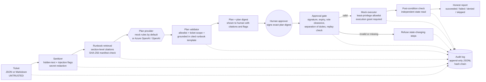

# IT Service Agent Demo: a controlled AI agent for IT service management

A small, fully offline-testable reference implementation of an **artificial intelligence (AI) agent that is allowed to help with IT tickets but not allowed to act on its own**.

The agent reads a ticket, retrieves and **cites** the relevant runbook sections, proposes remediation steps, and then **stops**. A named human approver must review the exact plan and sign an approval. Only then does a **least-privilege, allowlisted** mock executor carry out the steps, every step lands in a **tamper-evident (hash-chained) audit log**, and the final report says "done" only if the executor's own state proves it.

> **Synthetic data only.** All users, hosts, services, printers, and keys here are invented (`example.test` addresses). Nothing connects to a real system. The "executor" is a simulator.
>
> **Author:** Lonnie Thomas, an IT operations and service-delivery leader. This is a portfolio demonstration of control design for agentic AI, not a product and not a certification or compliance claim.

## Why this exists

Most "AI agent" demos show capability. Information technology (IT) leaders, including chief information officers (CIOs), get asked a different question: *what stops it from doing something it should not?* This project answers with controls you can read, run, and test:

| Question a CIO / auditor asks | Where it is answered |
|---|---|
| Can the model run something we never approved? | Allowlist enforced twice (agent **and** executor); unlisted actions are denied by default |
| Can a ticket talk the agent into it (prompt injection)? | Ticket text is data; actions must come from a pinned runbook template, be in scope, and be approved by a human |
| Who approved what, and can they fake it? | Signed, time-boxed, single-use approvals bound to the SHA-256 digest of the exact plan; separation of duties |
| Can someone rewrite the history? | Append-only JSON Lines log with a SHA-256 hash chain; optional external anchor; execution fails closed if the chain is broken |
| Will it tell us it fixed something when it did not? | Success is derived from executor result **plus** an independent post-condition check, never from model text |

## Architecture



### Trust boundaries

1. **Untrusted:** ticket body, title, attachments, anything an end user or a connected tool can write.
2. **Semi-trusted:** the LLM's output (it may be manipulated), so it is treated as a *suggestion* and re-validated.
3. **Trusted but integrity-checked:** runbooks (hash-pinned), the allowlist (code), the approver registry.
4. **Human decision point:** the approver. The agent cannot approve for them.

## Quickstart

Requires Python 3.10+. The agent itself has **no runtime dependencies**; `pytest` is only for tests.

```bash
git clone <this repo> && cd it-service-agent-demo
make install          # creates .venv, installs the package and pytest
make test             # offline test suite
make demo             # end-to-end walk-through (see "Real output" below)
make demo-injection   # same flow on the prompt-injection sample ticket
```

No `make`? Use the equivalents:

```bash
python3 -m venv .venv && .venv/bin/pip install -e . -r requirements.txt
.venv/bin/python -m pytest
PYTHON=.venv/bin/python ./scripts/demo.sh
```

### Step by step with the CLI

```bash
itsa triage  examples/tickets/INC-1001-account-lockout.json --out plan.json   # proposes, executes nothing
itsa approve plan.json --approver pat.ortiz@example.test                       # a human types the digest prefix
itsa execute plan.json .itsa/approval-INC-1001.json                            # runs only if the approval verifies
itsa verify-log                                                               # hash-chain integrity check
```

(`python -m it_service_agent ...` works as well.) There is intentionally **no `--yes` / auto-approve flag**. `approve` refuses to run without either an interactive prompt or an explicit `--confirm-digest` that the approver supplies. `scripts/demo.sh` scripts that step to make a demo possible and says so in its output.

### Sample tickets (`examples/tickets/`)

| Ticket | Format | What it shows |
|---|---|---|
| INC-1001 account lockout | JSON | Cited plan: check status, then unlock (low risk) |
| INC-1002 stuck printer | Markdown | Entity extraction (`PRN-FL2-01`) from free text |
| INC-1003 file share degraded | JSON | Medium-risk service restart |
| INC-1004 group access request | JSON | High-risk change: needs the IT operations manager's clearance; group comes only from a structured field |
| INC-1005 **injection demo** | JSON | HTML comment, zero-width characters, Unicode tag characters, attachment payload, fake "pre-approved" claim: the plan is unchanged and flags are surfaced to the approver |
| INC-1006 phishing report | JSON | Guidance-only runbook: zero actions are ever proposed |
| INC-1007 suspicious sign-in | JSON | Medium-risk session revocation |

## Design principles

1. **Human in the loop for every state change.** Read-only checks may run; anything that changes state needs a valid approval. No auto-execute path exists in the code.
2. **Approvals are evidence, not flags.** Signed (HMAC-SHA256 in the demo), bound to the plan digest, time-boxed (default 15 minutes, hard cap 60), single use (consumed *before* execution), role-limited (`low` / `medium` / `high` clearance), and never self-approved.
3. **Deny by default, enforce twice.** The allowlist lives in `policy.py` and is re-checked inside the executor. Parameters are validated (user pattern, protected accounts, approved groups and services only).
4. **Ground every action.** An action is accepted only if it is an `ACTION` template in a runbook section that was retrieved for this ticket, with matching parameter keys. The citation (file, section, line range, section hash) travels with the action into the approval screen and the log.
5. **Treat model output as untrusted input.** The provider interface returns *proposals*; hostile or hallucinated output is dropped and logged, not executed.
6. **Evidence you can verify.** Hash-chained JSONL; the agent refuses to execute if the chain does not verify. `anchor()` exports a checkpoint to store outside the agent's reach (detects tail truncation).
7. **Honest reporting.** `succeeded` requires executor success **and** an independent post-condition read. Failures halt the plan; unexecuted steps are `skipped`, never silently "done".
8. **Fail safe.** Provider error or malformed model output degrades to "route to a human technician" with zero actions.
9. **Least data.** Secrets in ticket text are redacted from summaries and logs; the log records a ticket hash, not the full body.

## Pluggable LLM provider

Default: `MockProvider`, a deterministic rule-based planner that fills runbook templates. Tests need no network or keys.

Optional adapter (`OpenAICompatibleProvider`, standard library `urllib` only), selected with `--provider` or `LLM_PROVIDER`:

```bash
# Azure OpenAI
export LLM_PROVIDER=azure
export AZURE_OPENAI_ENDPOINT=https://<your-resource>.openai.azure.com
export AZURE_OPENAI_DEPLOYMENT=<your-deployment>
export AZURE_OPENAI_API_VERSION=2024-06-01            # optional
export AZURE_OPENAI_API_KEY=...                       # or AZURE_OPENAI_AD_TOKEN=<Microsoft Entra ID bearer token>

# OpenAI
export LLM_PROVIDER=openai
export OPENAI_API_KEY=...  OPENAI_MODEL=gpt-4o-mini   # OPENAI_BASE_URL optional
```

The adapter sends the ticket inside an `<untrusted_ticket>` block, offers only retrieved runbook templates, and then the same validator runs on whatever comes back. The adapter is unit-tested with a fake transport (request shape, hostile output, malformed JSON, network failure). **It has not been exercised against a live Azure OpenAI or OpenAI endpoint in this repository.**

## How it maps to the Microsoft stack

These are **integration points**, not implemented features. The demo simulates them locally so the control design is visible.

| Demo component | Microsoft / ITSM integration point |
|---|---|
| Approver registry and role clearance (`approvals.py`) | **Microsoft Entra ID** groups and app roles; approver sign-in protected by **Conditional Access** (phishing-resistant multifactor authentication, compliant device); **Privileged Identity Management** for just-in-time approver rights |
| Approval signature (HMAC) | An approval service outside the agent's trust boundary, using asymmetric signing (for example keys in **Azure Key Vault**) and an Entra ID-authenticated approver; or an approval record in ServiceNow / Power Automate |
| `OpenAICompatibleProvider` | **Azure OpenAI Service** deployment; use managed identity / Entra ID tokens instead of keys, private endpoint, content filtering, and data-processing terms appropriate to your tenant |
| Executor identity | A dedicated **workload identity / managed identity** per action class with only the Graph or Azure RBAC permissions that action needs (the allowlist is the code-level mirror of that least privilege) |
| Audit log (`audit.py`) | Ship JSONL to **Azure Monitor / Log Analytics** (Logs Ingestion API) and **Microsoft Sentinel**; analytics rules on `approval.rejected`, `injection.flagged`, `provider.error`; store the `anchor()` checkpoint in immutable (WORM) Blob storage |
| Ticket intake and change records | **ServiceNow** incident/change (or any ITSM) as the source of tickets and the system of record for approvals; the plan digest becomes a field on the change |
| Executor (`executor.py`) | **Power Automate** flows or ServiceNow Flow Designer actions behind an approval step; Microsoft Graph for account operations |
| Runbook store | Versioned repo or knowledge base with pull-request review; the manifest check becomes a signed-commit / release-artifact check |

## Repository layout

```
src/it_service_agent/   agent, approvals, audit, executor, llm providers, policy, retrieval, sanitizer, CLI
runbooks/               sample synthetic runbooks + MANIFEST.sha256 (pinned hashes)
examples/               sample tickets, demo approver registry (synthetic keys)
tests/                  pytest suite (offline)
scripts/demo.sh         end-to-end demo
THREAT_MODEL.md         STRIDE table, OWASP LLM Top 10 and NIST AI RMF mapping, residual risk
```

## Real output (from `scripts/demo.sh`)

```
=== 2. Try to execute WITHOUT approval (state-changing steps must be refused) ===
NOT FULLY COMPLETED: 1/2 succeeded, 0 failed, 0 denied, 1 skipped.
  1. check_account_status {'user': 'jordan.lee@example.test'}: succeeded - locked=True sessions=2
  2. unlock_account {'user': 'jordan.lee@example.test'}: skipped - valid human approval required
  refused: no approval presented
...
=== 4. Execute with the approval ===
ALL ACTIONS SUCCEEDED (verified): 2/2 succeeded, 0 failed, 0 denied, 0 skipped.
...
=== 5. Replay the same approval (must be refused) ===
  refused: approval already used (replay)
=== 6. Verify the audit hash chain ===
audit log: 20 entries, head 1e20872e355c2b8b…  -> OK
=== 7. Tamper with one audit entry, verify again ===
audit log: 20 entries, head 1e20872e355c2b8b…  -> TAMPERING DETECTED
  - line 3: entry hash mismatch (content modified)
```

## Test suite

```
$ python -m pytest
90 passed
```

Coverage includes: ticket parsing, retrieval and citations, runbook poisoning, allowlist and parameter validation, executor least privilege, approval forgery / expiry / replay / wrong plan / under-privileged approver / self-approval, audit modification / deletion / reordering / insertion / truncation, prompt-injection payloads, hostile LLM output, executor failures and silent no-ops, and the CLI flow.

## Independent security testing

The sibling project [`agent-security-test-kit`](../agent-security-test-kit) runs a black-box suite (hidden instructions in
tickets, unauthorized actions, forged and replayed approvals, false "done" claims, audit-log tampering) against this agent
through an adapter. Result at commit `c0a973d`: 30/30 tests (83/83 cases) pass; the same suite fails 26 of 30 tests on a
deliberately vulnerable toy agent, and fails the expected test when I disable single controls here (replay protection,
signature check, post-condition check, hash-chain check). Caveat: the kit uses the deterministic mock model, so it tests the
controls, not a live model's resistance to persuasion.

## Known limitations (read before reusing)

* The executor is a simulator. A real deployment needs real identity, network, and change-management integration.
* HMAC approvals mean the verifier can also forge; see THREAT_MODEL.md for the production replacement.
* The injection detector is a heuristic **signal for the human approver**, not a security boundary. The boundary is structural (allowlist, grounding, approval).
* The audit log detects tampering but cannot prevent deletion of the file; it needs external anchoring and write-once storage.
* Retrieval is a small lexical ranker. It is easy to read, not state of the art.
* Not a compliance artifact: nothing here claims alignment-by-implementation with any framework; mappings are illustrative design guidance.

## Acronyms

AI: artificial intelligence. CIO: chief information officer. IT: information technology. ITSM: IT service management. LLM: large language model. OWASP: Open Worldwide Application Security Project. NIST AI RMF: National Institute of Standards and Technology Artificial Intelligence Risk Management Framework. STRIDE: Spoofing, Tampering, Repudiation, Information disclosure, Denial of service, Elevation of privilege. SHA-256: Secure Hash Algorithm, 256-bit. HMAC: Hash-based Message Authentication Code. JSON: JavaScript Object Notation. JSONL: JSON Lines (one JSON object per line). CLI: command line interface. Entra ID: Microsoft's cloud identity service. PIM: Privileged Identity Management. WORM: write once, read many. MIT: the MIT open-source license.

## License

MIT. See `LICENSE`.
